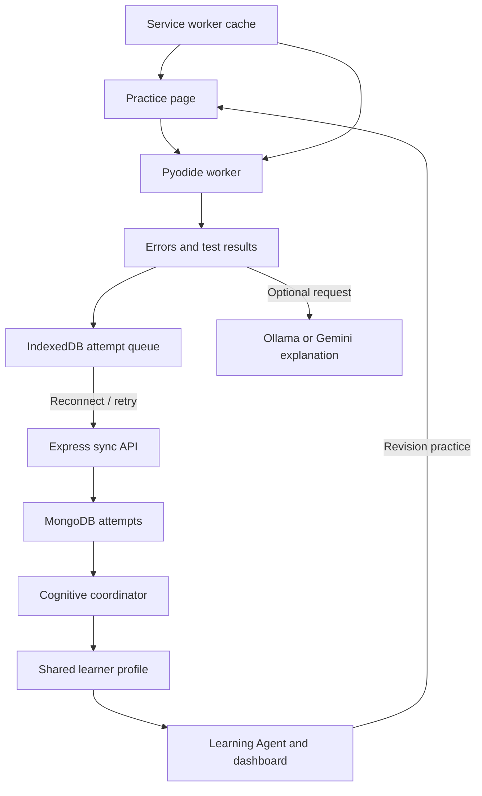

<<<<<<< HEAD
# CACM Learning with Research Agent and Gemini

## Start the upgraded app

Keep the whole folder together. Node.js 22 LTS and Python 3.10 or later are recommended. MongoDB must already be running.

```bat
npm ci --omit=dev
python -m venv .venv
.venv\Scripts\activate
python -m pip install -r research/requirements.txt
copy .env.example .env
npm start
```

If `.env` exists, keep it and update settings instead of copying over it. On macOS/Linux activate with `source .venv/bin/activate` and use `cp` instead of `copy`.

Set these variables in `.env`:

```dotenv
GEMINI_API_KEY=your_key_here
GEMINI_MODEL=gemini-2.5-flash
RESEARCH_GEMINI_MODEL=gemini-2.5-flash
RESEARCH_PYTHON=python
CODING_AI_PROVIDER=gemini
```

Start Node from the activated environment so `python` resolves to the environment containing the dependencies. Alternatively set RESEARCH_PYTHON to the full path to that environment's Python executable, without surrounding shell quotes. Configure a Gemini model available to your account that supports JSON responses. The model name is configurable because provider availability changes. Keep YOUTUBE_API_KEY and MONGO_URI as before. Do not put keys into browser files.

Open http://localhost:3000 and click **Research papers**, or visit http://localhost:3000/research/. Use the same Student ID as the learning page, enter a focused topic and choose 1–10 papers (the UI offers 3, 5 or 10). The search ANDs topic keywords and sorts arXiv results by relevance. Use fewer keywords if no papers match. Results are an exploratory, bounded literature review, not a systematic review.

## Research workflow

The Express API starts one background Python worker at a time. Status and previous job requests are saved on disk. The worker searches arXiv, downloads PDFs with size limits, extracts page text and heuristic section headings, chunks text at tokenizer offsets, and asks Gemini for structured findings. Each retained finding has an exact source quote, PDF page, section, and stable evidence ID. Quotes absent from extracted text are rejected. Quote matching verifies source presence, not semantic entailment; review the claim against its quote.

BGE embeddings use BAAI/bge-base-en-v1.5 locally. The first run downloads its weights and may take several minutes. Tokenizer-based chunks stay below the model's 512-token context. Normalized limitation and future-work embeddings are grouped using average-linkage agglomerative clustering and cosine distance with a configurable-in-code 0.35 threshold. That threshold is a heuristic requiring evaluation. Empty and single-evidence cases are supported. Gemini proposes gaps from clusters; only references to known evidence from at least two papers are retained. This is a reference check, not proof of research novelty. It deliberately returns no gap when supporting evidence is insufficient.

Every job saves:

```text
outputs/<student-id>/<job-id>/latest_report.json
outputs/<student-id>/<job-id>/extracted_paper_sections.json
outputs/<student-id>/<job-id>/research_report.docx
```

These filenames are kept inside separate job folders to prevent overwrites. The Word report includes paper coverage comparisons, paper-wise methods/datasets/results/limitations/future work, cross-paper evidence clusters, potential gaps, proposed experiments and processing warnings. JSON and Word downloads become available when report generation completes. PDFs and page text stay in the same job folder for inspection. Scanned PDFs without a usable text layer are marked as failed; OCR is not included. PDF section detection is heuristic, especially for multi-column papers. Failed papers are listed and do not silently become evidence.

JSON generation uses Gemini JSON response mode with local validation. Incomplete provider output is rejected. Rate-limited requests use bounded retries. The app uses the Gemini REST API directly; no additional Gemini SDK is required. Existing LangGraph nodes call a small Gemini adapter preserving their invoke interface; optional coding explanations also support `gemini`, `ollama` or `none`. Python execution and factual grading remain independent of the LLM.

## Operating limits

This preserves the existing local-development Student ID identity scheme. Student IDs separate records but are not authentication. Research outputs do not measure student mastery and are not automatically inserted as learner-performance evidence. Research-to-lesson or research-to-coding task assignment is not implemented in this upgrade.

One research job runs at a time per Node process, with a 60-minute timeout. Use one server process. After a server restart, unfinished jobs are reported as interrupted; start a new run. Completed reports remain available. There is no automatic job resumption or output cleanup. Research requires internet, a Gemini key and a downloaded BGE model; offline Python practice remains available as before. Review costs and rate limits in your provider account: extraction calls scale with the number and length of paper chunks.

## Validation for this upgrade

```bat
npm run test:research
python -m unittest discover -s test -p research_pipeline_test.py
npm run test:core
npm run test:roadmap
npm run test:student
```

Live arXiv/Gemini requests, BGE model download and MongoDB writes require external services. Tests with fixtures do not establish live provider success. The delivered validation log records which checks actually ran.

## Existing offline coding documentation

# CACM learning app with offline Python practice

This project integrates a real Python runner into your uploaded `server.js`. It preserves the learning, video, quiz, and course dashboard routes, and replaces the old loop-specific coding checker with a separate `/coding/` workspace.

**You do not need Ollama or fine-tuning to use the coding runner.** Pyodide executes Python and reports actual syntax/runtime errors. Supplied tests check outputs. The built-in bank includes 12 worked solutions with explanations. Optional AI suggestions never decide the grade.

## Update an existing installation: coding mistakes in the learning path

For the focused update, use `CACM-Learning-Path-Changes.md` beside this project. It lists the exact edits; you do not need to download the whole project again. This change needs no new dependency or environment variable.

The Coding page's **Learning path** link now waits for sync and opens the existing path. Pending coding reviews appear in that path before the next unfinished lesson, and **Next step** points to the review. Two distinct successful solutions after the last failure resolve it and restore the next lesson. Selecting a course shows its path instead of jumping past a coding review.

Keep the same Student ID in both modules. Select a course before running code to link attempts explicitly. Independent practice is matched to relevant course text using simple topic rules; unmatched revision remains visible separately. If there is no generated course, pending coding reviews form a usable practice path by themselves. Gemini is not required for these path updates.

Click **Sync now** after installing this fix to rebuild the path from already saved attempts. If using an old offline pack, click **Download offline pack** while connected, wait for **Offline pack ready**, then reload Coding. Saved attempts and drafts remain in the browser. The learning dashboard shows synced server state; it requires a connection to the server.

## Full-project update: navigation and revision videos

1. Stop the running server with **Ctrl+C**. Extract the updated ZIP into a temporary folder.
2. From its `cacm-learning` folder, copy **`server.js`** and the **`coding` folder** into your existing project folder (the one containing your current `server.js`). Replace matching files. Keep your existing `.env`, installed dependencies, and database.
3. Run **`npm start`** in your existing project. Open **http://localhost:3000/** and reload the page.
4. If you installed the earlier offline pack, open coding practice while connected, click **Download offline pack**, wait for **Offline pack ready**, and reload that page. This updates the cached interface without clearing saved attempts or drafts.

No new dependency is needed for this update. The home now has four entry buttons:

| Button | Opens |
|---|---|
| Build a course | Learning Agent: enter a topic and click **Plan my course** |
| Learn one topic | Video search: enter a topic and click **Find videos** |
| Practise your code | Python workspace: choose a bank problem or **Paste my own question**, then **Run tests** |
| Review your progress | Course dashboard, quiz history, and synced coding revision tasks |

The coding header now links back to Home, Learning path, and Dashboard with the same Student ID. The home no longer waits for YouTube before its buttons load. Browser Back/Forward works between the home views. Student changes clear the previous student's displayed learning workspace, and late course responses cannot replace a newly selected workspace.

Course planning and AI quizzes need a working **`GEMINI_API_KEY`**; video search needs **`YOUTUBE_API_KEY`**. Both need internet. **`CODING_AI_PROVIDER=none` only disables optional coding explanations.** It does not supply a provider for the Learning Agent. Missing keys now produce a visible setup message; failed Gemini calls no longer create a misleading generic course. The home setup panel reports whether keys are configured, not whether they have been accepted by their providers.

## Start on Windows

If the coding API logs `Student ID must use 1–80 letters, digits, underscores, or hyphens`, load the same existing Student ID used in Learning, then choose **Sync now**. Spaces, email addresses, empty IDs, and IDs over 80 characters are rejected. Do not switch to a new ID merely to hide the error: histories are attached to their original IDs. The client now blocks invalid-ID sync before contacting the server and blocks code runs until a matching student is loaded. Offline pack version v5 contains these checks. The `[db] removed obsolete index userId_1` startup message is an expected index migration, not this validation error.

1. Extract `cacm-learning.zip`. Keep the whole `cacm-learning` folder together. Do not copy only `server.js`: it imports the `coding` module and serves the browser files from that folder.
2. Install Node.js 22 LTS or a compatible newer LTS version. Start your existing MongoDB service. MongoDB Compass is a client; the database service must also be running.
3. Open Command Prompt **inside the extracted folder containing `server.js` and `package.json`**, then run:

```bat
npm ci --omit=dev
if not exist .env copy .env.example .env
npm start
```

If `.env` already exists, keep your existing file and add any missing settings from `.env.example`. Do not overwrite your keys or connection string. The supplied `.env.example` uses local MongoDB at `mongodb://127.0.0.1:27017/ai_tutor`. Change `MONGO_URI` if your database uses another address.

4. Open **http://localhost:3000**. Use your existing Student ID, then choose one of the four workspaces. **Practise your code** opens Python practice. You can also open **http://localhost:3000/coding/** directly.
5. Click **Download offline pack**, and wait for **Offline pack ready**. Bookmark the `/coding/` page. Disconnect from the internet, reload that page, and run a question.

Always use the same URL, port, and browser profile. `localhost` and `127.0.0.1` have separate browser storage. Do not open `index.html` by double-clicking it. A hosted installation needs HTTPS for offline browser features; localhost works during development.

The first installation/download needs internet. After the pack is cached, this practice page and the bundled Python standard library work offline. The pack is approximately 14 MB plus application assets; it does not contain an LLM or every third-party Python package. Video playback, online course generation, MongoDB syncing, and server verification require their respective services.

## Try the error that confused Qwen

Click **Try the missing-colon example**, then **Run tests**. Python reports `SyntaxError: expected ':'` and identifies the line. There is no manual `range(...)` pattern used to grade the code.

For your original snippet, the corrected line is:

```python
for i in range(1, 5):
```

This prints 1 through 4 after the indented `print(i)` executes. For the built-in “Print 1 through N” question, read `n` and use `range(1, n + 1)`. Its tests vary `n`, so a hard-coded loop cannot pass all tests. A `while` loop or another valid implementation can also pass.

## Complete architecture



| Component | Implemented responsibility | Main files |
|---|---|---|
| Practice page | Built-in/pasted questions, editor, results, history, worked solutions, revision links | `coding/public/index.html`, `app.js`, `app.css` |
| Coding Agent | Actual Python compilation/execution, comparison with expected outputs, diagnostic-based hints | `worker.mjs`, `runner.js`, `harness.py`, `core.js` |
| Offline pack | Caches this page, its data, and pinned Pyodide runtime; detects and repairs missing cached assets | `sw.js`, `manifest.webmanifest` |
| Local persistence | Drafts and attempts partitioned by Student ID; retry queue and export | `db.js`, `app.js` |
| Sync API | Validates reports, recomputes verdicts from reported outputs, rejects conflicting reused IDs, acknowledges retries | `coding/index.cjs` |
| Cognitive coordinator | Projects distinct attempt evidence into a bounded performance estimate and revision tasks | `core.js` → `project()`, `index.cjs` → `refresh()` |
| Learning Agent and path | Reads shared coding evidence during roadmap generation; existing paths insert pending revision before the next unfinished lesson | `coding/roadmap.cjs`, `server.js` → `fetchHistoryNode()` and dashboard |
| Revision videos | Looks up topic videos for coding revision tasks; opens the learning viewer and returns to the saved code | `coding/public/revision.js`, `app.js`, `server.js` |
| Optional explanation | Sends the diagnostic, question, and code to the chosen model; displays an unverified suggestion separately | `index.cjs` → `/explain` |
| Optional server judge | Submits code to a configured Judge0 sandbox, polls completion, grades bank tests on the server | `judge.cjs`, `index.cjs` → `/verify` |

These are cooperating software components using shared learner state. The cognitive coordinator is an explicit rule-based policy, not a newly trained neural model. The Research Agent pipeline is described above. No fine-tuning pipeline is included.

## How attempts update learning

An attempt records the question and its tests, source code, Student ID, optional course ID, timestamp, interpreter report, and verdict. MongoDB stores immutable attempt payloads in `CodingAttempt`. The unique `(userId, attemptId)` index makes a retried upload idempotent. An identical retry receives a `duplicate` acknowledgement; reusing the ID with different content is rejected.

The coordinator considers the latest 500 accepted attempts, keeping up to 20 distinct solution/test combinations per topic. Re-running unchanged code does not add mastery evidence. If an equivalent solution has a server-verified result, it takes precedence over its local report.

The displayed estimate is `(successful distinct solutions + 1) / (distinct solutions + 2)`. Evidence labels are based on sample count. These are transparent practice heuristics, not calibrated measures of understanding. A syntax error is recorded as a syntax error; the system does not pretend it has discovered a specific algorithmic misconception.

Two distinct unsuccessful solutions without an intervening pair of successful solutions create a pending revision task for that topic. Two distinct successful solution attempts after the last failure resolve it. Cancelled runs, engine failures, and runs with no expected outputs do not count toward the estimate.

Revision tasks are stored in `LearnerProfile.codingState` and in relevant courses' `LearningHistory.codingRevisionTasks`. An explicitly linked task applies only to its recorded course IDs. Independent tasks are matched using topic words or Python/programming/DSA course text; this is a rules-based association, not a diagnosed misconception. Unmatched independent tasks appear separately, and students without courses still see a coding revision path. The dashboard derives `learningPath` and `nextStep` from the latest shared state, so a course created after an attempt can also show relevant review. Original curriculum indices, completed lessons, and video progress are preserved. The revision step is recommended, not a lock on later lessons. New roadmap requests also receive relevant coding evidence through the Learning Agent's history prompt.

**Sync now** rebuilds the projection even when all local attempts were previously acknowledged. Learning-path navigation waits for that sync. If some attempts cannot sync, the dashboard identifies that it is showing the last server state. Another open dashboard tab refreshes after a successful coding sync for the same Student ID.

## Topic videos after coding difficulties

The earlier version displayed revision instructions and another practice button, but did not call video search. Revision cards now fetch up to **three topic videos** using the existing `/api/youtube/search` endpoint. The Learning dashboard also offers **Find topic videos** beside its coding revision tasks.

- **Automatic review:** the existing two-distinct-failures policy opens a revision task and requests videos while connected. It does not use a fixed mastery-percentage cutoff. Running unchanged code against unchanged tests repeatedly counts as one solution.
- **Request a review yourself:** each recorded, classified topic without a pending task offers **Find revision videos**, including after one attempt. One failed solution does not establish that a concept is weak.
- **Watch and retry:** **Watch lesson** opens the Learning workspace with the same Student ID. **Return to my code** restores the selected course, bank question or custom-question form, and saved draft. Watching the lesson does not change the coding estimate or resolve the task; subsequent tested solutions provide that evidence.
- **Configuration:** set `YOUTUBE_API_KEY` in your existing `.env` and restart the server. Gemini is not required, and `CODING_AI_PROVIDER=none` is supported. Missing keys, quota/network errors, and empty results display messages and a **Search YouTube** link. The coding runner remains available.
- **Offline:** question practice, hints, and attempts still work. Previously fetched video titles are cached locally, with a notice to reconnect for playback. Videos themselves are not downloaded in the offline pack. Reconnecting refreshes the displayed revision resources.

Queries use the bank question's topic or the topic the student selects for an external question. `unclassified` produces no topic estimate or video recommendation until a supported topic is selected for later attempts. A syntax error in a loops question is evidence of a failed attempt, not proof of a loops misconception. These resources are topic-search suggestions; the app does not verify the educational accuracy of the video contents.

Successful video metadata is reused for six hours. Repeated renders share a pending request, and failed automatic searches pause for a minute; **Refresh videos** explicitly retries. Only the topic search query is sent to YouTube, not student code or their learning history.

## Use questions from LeetCode or other sources

Select **Paste my own question**, enter the title and problem text, choose a topic, and supply test cases. Topic selection is your annotation; it is not an AI-inferred diagnosis. “Unclassified” saves the attempt without assigning concept mastery.

For a function returning an answer:

```python
def solve(nums, target):
    return Solution().twoSum(nums, target)
```

Include your `Solution` class above the adapter. A test can be:

```json
[{"args":[[2,7,11,15],9],"expected":[0,1]}]
```

For a complete `input()` / `print()` program, choose standard input/output mode:

```json
[{"stdin":"3\n","expected":"1\n2\n3\n"}]
```

Function outputs use exact JSON comparison. Output mode normalizes Windows line endings and trailing newline characters; other whitespace remains significant. For multiple valid answers, unordered output, linked lists, trees, or custom classes, adapt the returned result to a canonical JSON value. Use strings for integers exceeding JavaScript's safe integer range, `2^53 - 1`. Large integer return values otherwise produce an explicit encoding error.

You can omit `expected` for an exploratory run. The result then says **unverified** and does not count as success. The app does not fetch LeetCode's hidden tests, infer a complete specification from prose, or guarantee a solution to an arbitrary pasted problem. Passing supplied tests is evidence for those inputs, not a proof of universal correctness or time complexity.

## Optional model explanations

The default is:

```dotenv
CODING_AI_PROVIDER=none
```

For your already downloaded Ollama model, run Ollama on the same machine as the Node server and set:

```dotenv
CODING_AI_PROVIDER=ollama
OLLAMA_URL=http://127.0.0.1:11434
OLLAMA_MODEL=qwen2.5-coder:1.5b
```

Restart Node, then click **Ask for an AI explanation**. This does **not** make Qwen reliable: it only supplies factual execution evidence to the model and keeps its suggestion separate from the verdict. If the Node server and downloaded Ollama model both run on your laptop, this route can operate without internet. A downloaded page alone cannot launch Ollama, and a remote Node server cannot reach your laptop's localhost.

For the app's existing Gemini integration, configure `GEMINI_API_KEY`, `GEMINI_MODEL`, and `CODING_AI_PROVIDER=gemini`. That optional request sends the submitted question, code, and diagnostic to Gemini. No provider is contacted automatically for coding explanations. The video and AI course features continue to use their existing `YOUTUBE_API_KEY` and Gemini settings.

## Optional independent server verification

Set `JUDGE0_URL` to your Judge0 base URL, with no `/submissions` suffix. Add the appropriate RapidAPI headers or self-hosted auth token from `.env.example`. Set the Python language ID supported by your instance. Restart Node.

The **Verify on server** button first syncs a built-in-bank attempt, then executes it with public and server-only tests. The server uses asynchronous submission polling; an empty response, service failure, or incomplete report never becomes a passing result. The Python version on Judge0 may differ from Pyodide's version. Judge0 execution is optional and was not tested against a live provider in this delivery.

The Express host never launches student Python through `exec` or `subprocess`. The browser worker has a 60-second startup budget and a separate 4-second total execution budget; stopping it terminates the worker. Each new run uses a new worker. Within a run, each test receives fresh student globals and copied arguments. A worker is a responsiveness boundary, not a security sandbox for deliberately hostile snippets; it retains browser-origin capabilities.

## Scope and operating assumptions

- This is a local development integration. Student IDs separate records but are **not authentication**. The default host binding is `127.0.0.1`. Before a public multi-user deployment, add actual authentication/authorization, rate limits, and an execution isolation design appropriate to that deployment.
- Browser results have `browser_reported` provenance. Recomputing a verdict from reported outputs does not authenticate browser execution. Only a successful separate judge run adds `server_verified` evidence. This is a personal learning system, not a tamper-proof examination platform.
- Projection updates are serialized per student inside one Node process. Multiple server replicas require a distributed lock or a transactional projection strategy.
- Offline storage belongs to this browser profile. The app requests persistent storage where supported, but eviction or user clearing can still remove data. Use **Export my attempts** for a backup. Automatic restore/import is not included.
- The offline pack covers Python and its bundled standard library. This release does not execute C++, Java, or arbitrary pip dependencies.
- This architecture alone does not establish research novelty. A research claim needs comparison with prior work and measured evidence for the proposed learning or coordination improvement.

## Validation included with the source

Install development dependencies when you want to run the tests:

```bat
npm ci
npm run test:core
npm run test:roadmap
npm run test:student
npm run test:db
npx playwright install chromium
npm run test:browser
npm run test:home
```

`test:core` passed **11 tests** using the actual Pyodide runtime, including all 12 worked solutions and their extra tests, syntax/runtime diagnostics, wrong loop bounds, later-test failures, JSON precision, and evidence deduplication. Judge0 protocol handling was tested with simulated responses.

The real Chromium browser checks passed for missing-colon detection, cache installation and repair, offline reload, draft/attempt persistence, timeout recovery, external questions, student separation, responsive layout, existing-dashboard navigation, and reconnect queue behavior. Those checks used a **simulated API**, so they do not establish a successful MongoDB write.

The navigation update was checked in real Chromium at desktop and mobile widths. `test:home` covers all four home entries, top navigation, course/topic submission, keyboard video selection, a failed YouTube player download, missing-key messages, late responses, dashboard lesson entry, coding return links, draft preservation, student switching, and Back/Forward. Missing-key errors use the actual API; successful course generation, video search, and dashboard/history responses are fixtures. The offline browser checks were also rerun after updating the cache version and navigation.

In fixture mode, `test:browser` also checks manual video lookup after one attempt, automatic video cards after repeated failures, request/cache reuse, missing YouTube keys, empty results, the learning-viewer handoff, bank/custom draft restoration, offline video metadata, and dashboard video links. Video search and history/sync successes are simulated; live YouTube search and playback are not claimed as tested.

The real MongoDB integration tests are included in `test/api.test.cjs` but could not run here: this execution environment rejected a native MongoDB startup operation with `Operation not permitted`. Run `npm run test:db` on your laptop to verify the actual unique index, retry behavior, course revision persistence, and student-scoped history. The test uses a disposable MongoDB 7.0.14 instance, not your production database. Live Gemini/Ollama responses and a live Judge0 deployment were not tested.

For the learning-path fix, five additional tests passed: insertion before the next lesson without progress changes, recovery and completed courses, explicit/independent course matching, practice paths without courses, and the actual Express sync/profile/dashboard route chain using in-memory model methods. That route check covers duplicate retries, same-title courses, cross-student rejection, old-evidence rebuild, and revision resolution. Both browser suites also passed after this fix, including Coding → Learning path, next-step revision, unchanged lesson indices, offline navigation messaging, and next-lesson restoration after successful retries. These checks do not establish a live MongoDB write on your laptop.

Four additional client-function checks passed for the Student ID fix: repeated startup sync sends no empty ID, invalid/non-string IDs are rejected locally, valid IDs are sent unchanged, and running code requires a matching loaded student. These checks use an in-memory DOM and transport; they do not connect to the user's MongoDB.

## Official runtime references

- [Pyodide: downloading and deploying](https://pyodide.org/en/stable/usage/downloading-and-deploying.html)
- [Pyodide: module web workers](https://pyodide.org/en/stable/usage/webworker.html)
- [Ollama chat API](https://docs.ollama.com/api/chat)
- [Judge0 API](https://ce.judge0.com/)

Pyodide is pinned to `314.0.7`; `package-lock.json` fixes the installed dependency graph. When changing runtime files, question data, or browser code, increment the service-worker cache version and the question-pack version where appropriate.
=======
# Personalized-Hybrid-Study-System
Sem7 Project - Personalized Hybrid Study System (PHSS)

To run : npm install dotenv express mongoose axios @langchain/langgraph @langchain/google-genai @langchain/core
>>>>>>> origin/siri-priya
