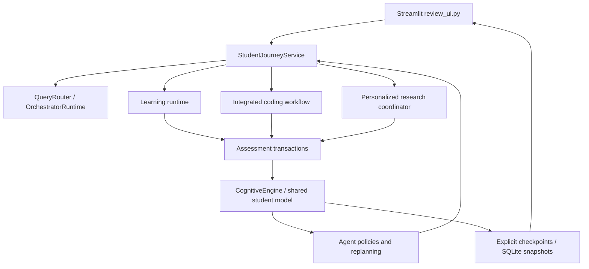

# Architecture

`review_ui.py` is the Python entry point. Student View, Advanced Coding Agent and Advanced Research Agent share the selected student and cognitive engine. CACM Professor Demo is a demonstration view; System Architecture explains the design. The Node/MongoDB prototype is separate.

| Component | Responsibility | Main implementation |
| --- | --- | --- |
| Learning Agent | Lessons, resources, adaptive practice, remediation, study planning | `app/learning_agent/runtime.py`, `agent.py`, `study_planner.py` |
| Coding Agent | Exercise policy, verified tests, review, hints, corrections, assessments | `app/coding_agent/integrated_workflow.py`, `verified_exercises.py`, `submission_controller.py` |
| Research Agent | Search plan, paper filtering, grounded analysis and assessments | `app/research_agent/personalized_coordinator.py`, `research_workflow.py`, `analysis_execution.py` |
| Orchestration | Natural requests, owner-scoped handoffs, shared service binding | `app/orchestrator/orchestrator_runtime.py`, `student_journey.py` |
| CACM infrastructure | Evidence, mastery, misconceptions, conflicts and diagnostics | `app/cognitive/` |
| Persistence | Versioned snapshots, migrations, restore, revision checks | `app/persistence/` |

These are application agents with bounded policies and tool workflows, not independently deployed processes or an inter-agent message broker. They communicate through the shared student model, evidence records and engine. CACM is not a fourth content agent.

## Evidence and recommendations

1. An agent observes assessed concept state and chooses an activity. Unknown concepts are labelled unassessed; their neutral prior is not evidence of ability.
2. The student submits an answer or original code. Providers evaluate semantics; coding also runs objective test cases.
3. A transaction associates the submission with a stable ID and fingerprint. Saved stages distinguish evaluation, cognitive update and follow-up generation.
4. `CognitiveEngine` validates ownership, records evidence, updates mastery/misconception hypotheses and compares cross-agent evidence for conflicts.
5. Policies consult the updated state. A genuine conflict can request a diagnostic; diagnostic evidence goes through the existing resolver.
6. Explicit checkpoints persist state. Subsequent recommendations and restored workflows use the same evidence history.

Concept identity uses whitespace/case normalization and a small explicit alias table. Distinct topics are not merged by fuzzy similarity. Migrations archive collisions instead of averaging or replaying scores.

## UI and providers

Streamlit calls Python services directly. The main Student View uses `study_workspace.py` and `streamlit_workspace.py` to persist an owner-scoped ordered sequence and render the actual learning, coding and research interfaces inline. A query authorizes initial content preparation: learning executes only when its step is active, coding loads/generates a validated exercise, and research starts one bounded page if no saved search exists. Failed/interrupted preparations require explicit retry. Selection, analysis, assessments and advancing remain student actions; advancement without evidence is labelled visited, never assessed.

`streamlit_journey.py` retains optional legacy/advanced handoffs and current policy previews. These shortcuts prepare the advanced views before widgets are built. Switching workflows retains supported active quizzes, coding drafts and research jobs. Genuine conflicts block sequence advancement until the existing diagnostic workflow resolves them through evaluated evidence. No new cognitive updater or fourth agent was introduced.

Gemini supplies routing, lesson/question generation and semantic analysis. Learning resources use YouTube, Wikipedia and curated official documentation. Research retrieval uses OpenAlex. Summaries retain source identities and checked abstract quotes; rejected records and shortfalls remain visible. External dependencies are not guaranteed offline content.

## Persistence and refresh

Originally progress lived only in `st.session_state`, which can disappear on refresh/reconnection. The current implementation restores a UUID profile selected through the `student` query parameter from `data/student_state/phss.sqlite3`.

Snapshots include the cognitive model, evidence, conflicts, progress, deduplication receipts and supported UI/assessment recovery state. Runtime clients are rebuilt and bound to the restored model; they are not serialized. The codec accepts known dataclasses and JSON-safe data, not arbitrary pickle. Schema migrations retain backups. Compare-and-swap snapshot revisions reject stale writes from another tab.

A URL identifier provides continuity, not access control. Losing the profile selection, deleting the database, using another checkout or deploying on ephemeral storage can still lose apparent continuity. Preserve the database and select the same profile.
